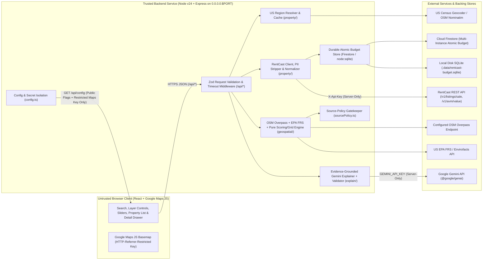

# System Architecture & Security Boundaries (`ARCHITECTURE.md`)

**Owner:** `integrator`  
**Runtime Baseline:** Node.js `v24` (`>= 22.5`, verified `v24.7.0`), TypeScript `5.7`, Express `4`, React `18`, Vite `6`, built-in `node:sqlite`

---

## 1. High-Level Topology

Foreal-Estate runs as a **single full-stack TypeScript/Node HTTP service** binding `0.0.0.0` on `PORT` (default `8080`) for zero-CORS simplicity, unified secret isolation, and single-container deployment on Google Cloud Run:

- **In Production (`NODE_ENV=production` / Cloud Run):** Express serves both the JSON API (`/api/*`) and the compiled static React SPA (`dist/client`, with SPA `index.html` fallback for non-`/api` GET routes) from one process on `0.0.0.0:$PORT`.
- **In Local Development:** `npm run dev` runs the Express server via `tsx` on `0.0.0.0:8080`, while `npm run dev:client` optionally runs Vite's HMR dev server on `5173` proxying `/api` to `http://127.0.0.1:8080`.

---

## 2. Trust Boundaries & Secret Isolation

### 2.1 Secret Classification Matrix

| Environment Variable | Classification | Injection Mechanism | Allowed Exposure |
|---|---|---|---|
| `RENTCAST_API_KEY` | **Confidential Server Secret** | Secret Manager -> Server `process.env` | Outbound server-to-RentCast `X-Api-Key` header **only**. Never in `/api/config`, client bundle, URLs, or logs. |
| `GEMINI_API_KEY` | **Confidential Server Secret** | Secret Manager -> Server `process.env` | Outbound server-to-Gemini SDK call **only**. Never in `/api/config`, client bundle, URLs, or logs. |
| `GOOGLE_PLACES_SERVER_KEY` | **Confidential Server Secret** | Secret Manager -> Server `process.env` | Optional server-side display-only Places lookup **only**. Never exposed to browser. |
| `GOOGLE_MAPS_BROWSER_KEY` | **Restricted Public Browser Key** | Env / Secret Manager -> `GET /api/config` | Intentionally served via `GET /api/config` (`mapsBrowserKey`) to initialize Google Maps JS SDK; protected by Google Cloud Console **HTTP referrer** and **Maps JavaScript API-only** restrictions. |
| `PORT`, `RENTCAST_GLOBAL_MONTHLY_LIMIT`, `RENTCAST_INITIAL_SPENT_CALLS`, `BUDGET_STORE_MODE`, `GOOGLE_CLOUD_PROJECT`, `GEMINI_EXPLAIN_MODEL`, `OSM_OVERPASS_URL`, `ENABLE_SYNTHETIC_DEMO_MODE` | **Non-Secret Runtime Config** | Cloud Run env vars / local `.env` | Safe boolean capability flags and numeric budget limits exposed via `GET /api/config`; raw internal filesystem paths and project credentials are never exposed. |

### 2.2 Defense-in-Depth Controls Against Secret Leakage
1. **Vite Client Prefix Restriction:** Only variables prefixed with `VITE_` could ever be statically inlined by Vite. None of our secret variable names use `VITE_`, and `src/server/config.ts` lives strictly inside `src/server/` (excluded from client imports).
2. **Explicit `GET /api/config` Allowlist:** `buildPublicRuntimeConfig()` constructs a brand-new DTO containing boolean readiness flags (`rentcastConfigured`, `geminiConfigured`, `mapsBasemapConfigured`, `placesContextConfigured`, `syntheticDemoEnabled`), `mapsBrowserKey: string | null`, default preferences, and budget ceilings—never serializing `process.env` or internal config objects.
3. **Log & Error Redaction:** Upstream HTTP wrappers catch provider errors, strip request headers and query strings, and map failures to typed internal error codes (`UPSTREAM_TIMEOUT`, `PROVIDER_UNAVAILABLE`, `QUOTA_EXHAUSTED`) so API keys never leak into Cloud Logging or HTTP error responses.
4. **Owner/Agent PII Stripping:** RentCast listing and property payloads are sanitized at the ingestion boundary in `src/server/property/` to delete `owner` names/mailing addresses and `agent` phone/email before caching or returning JSON.

---

## 3. Server Source-Policy Registry (`sourcePolicy.ts`)

To guarantee compliance with Google Maps Platform Terms of Service (Section 3.2.3) and ODbL / public-domain attribution rules, every geospatial record is gated by the deeply frozen server registry in [`src/server/geospatial/sourcePolicy.ts`](../src/server/geospatial/sourcePolicy.ts):

- **Amenity Scoring & Grid Overlap Eligible (`amenityScoringEligible: true`):** `osm_overpass`, `osm_extract`, and (only when `ENABLE_SYNTHETIC_DEMO_MODE=true`) `synthetic_demo`.
- **Separate Environmental Due-Diligence Eligible (`environmentalLayerEligible: true`):** `epa_frs` and opt-in `synthetic_demo`. Never merged silently into positive amenity convenience scores.
- **Unconditionally Barred (`analysisEligible: false`):** `google_places_context` and any unknown `sourceId`. Even if a request payload supplies `sourceId: "google_places_context"` with `analysisEligible: true` and valid coordinates, `partitionFacilitiesBySourcePolicy()` overrides the flag, rejects the record from kernel math, heatmaps, feature storage, and `/api/explain` evidence, and increments `rejectedCountBySource.google_places_context`.

---

## 4. Durable Atomic RentCast Budget Store

Because RentCast's Developer free tier allows **50 calls/month account-wide** before overage billing, an in-memory counter is insufficient on stateless Cloud Run containers or across local process restarts. Foreal-Estate implements a two-tier durable atomic budget store (`src/server/property/`):

1. **Global Monthly Ceiling (`< 50`):**
   - Configured via `RENTCAST_GLOBAL_MONTHLY_LIMIT` (clamped to `1..49`, default `35`) and `RENTCAST_INITIAL_SPENT_CALLS` (`>= 0`, default `0`).
   - Effective runtime allowance for the current `YYYY-MM` UTC month is $\max(0, L_{\text{config}} - S_{\text{initial}} - S_{\text{runtime}})$.
2. **Cloud Run Production (`BUDGET_STORE_MODE=firestore`, auto-defaulted when `K_SERVICE` is set):**
   - Uses Google Cloud Firestore REST/atomic transactional commit (`projects/{GOOGLE_CLOUD_PROJECT}/databases/(default)/documents/rentcast_budget/{YYYY-MM}`) authenticated via Cloud Run's attached service-account metadata token with TTL caching and optimistic-concurrency retry.
   - **Durable Session Persistence Across Restarts & Revisions:** Resolved session `AnalysisArea`, listings, and fetched AVM details are also persisted in Firestore (`foreal_sessions/{sessionId}`, 24h TTL) and hydrated on cache miss—because `--session-affinity` is best-effort and `--max-instances=1` neither guarantees persistent in-memory state across cold starts/revision rollouts nor acts as a monthly dollar spending cap.
   - **Explicit Safe Session-Expiry Recovery (`409 SESSION_EXPIRED`):** If a session expires past its TTL or is absent from both memory and durable storage, `/api/explain` and session-bound endpoints return `409 SESSION_EXPIRED` (`uiState: "recovery"`) without ever silently repeating paid RentCast calls.
   - **External Key Consumers:** Firestore's counter tracks Foreal-Estate usage plus configured `RENTCAST_INITIAL_SPENT_CALLS`; it cannot automatically observe unrelated external scripts sharing the same RentCast API key.
   - **Fails closed:** If Firestore is unreachable when `BUDGET_STORE_MODE=firestore`, no upstream RentCast call is dispatched.
3. **Local Development (`BUDGET_STORE_MODE=sqlite`):**
   - Uses Node v24's built-in `node:sqlite` (`DatabaseSync`) persisted at `SQLITE_BUDGET_PATH` (default `.data/rentcast-budget.sqlite`) with `BEGIN IMMEDIATE` transactions so budget state survives `tsx` reloads and server restarts without `node-gyp`.
4. **Per-Session Caps & Request Coalescing:**
   - Default session (`sessionExpanded: false`): max **1** `/v1/listings/sale` call (`limit <= 25`) + max **5** unique `/v1/avm/value` calls = **6 calls**.
   - Expanded session (`POST /api/sessions/:sessionId/expand`): max **1** listings call + max **10** unique AVM calls + max **1** optional `/v1/properties` call = **12 calls**.
   - Cache hits and coalesced duplicate in-flight requests spend **0** credits.

---

## 5. Lawful Source-Specific Caching Strategy

| Data Domain | Cache Key | TTL & Persistence | License Basis |
|---|---|---|---|
| US Region Resolution (`Census` / `Nominatim`) | Normalized query string or quantized `(lat, lng, radius)` | 24 hours (server LRU / SQLite) | US Public Domain / ODbL (`<= 1 req/s` Nominatim policy respected) |
| OSM Amenities (`osm_overpass`) | Quantized `(centerLat, centerLng, fetchRadiusMeters, categories)` | 6 hours (server LRU) | ODbL 1.0 with `© OpenStreetMap contributors` attribution preserved |
| EPA FRS Layer (`epa_frs`) | Quantized `(centerLat, centerLng, fetchRadiusMeters)` | 12 hours (server LRU) | US Federal Public Domain |
| RentCast Sale Listings | Quantized `(centerLat, centerLng, radiusMeters, propertyType)` | 1 hour (server session/LRU cache; no bulk export) | RentCast API Terms (single-app responsiveness & quota protection) |
| RentCast Property AVM | Canonical `propertyId` / normalized address | 1 hour (server session/LRU cache) | Avoids re-billing when clicking back and forth between homes |
| `google_places_context` | **Not indexed in spatial cache** (`place_id` only if used) | Ephemeral display pass-through only | Google Maps Platform ToS Section 3.2.3 compliance |

---

## 6. Request Validation, Timeouts & Grounded Explanation Pipeline

1. **Boundary Validation (`src/shared/schemas.ts`):** Every `POST /api/*` route validates request bodies with strict Zod schemas (`express.json({ limit: "256kb" })`), rejecting `NaN`/`Infinity`, out-of-range coordinates, negative preference weights (`w_c < 0`), out-of-bounds radii (`analysisArea.radiusMeters` clamped/validated to `[400, 5000]`), and oversized arrays with `400 VALIDATION_ERROR`.
2. **Bounded Upstream Timeouts (`AbortSignal.timeout`):**
   - Geocoding (`Census` / `Nominatim`): `6,000 ms`
   - Overpass (`OSM_OVERPASS_URL`) & EPA FRS: `10,000 ms` (partial degradation on failure)
   - RentCast (`/v1/listings/sale`, `/v1/avm/value`): `8,000 ms`
   - Gemini (`/api/explain`): `10,000 ms` (falls back cleanly to `explanationAvailable: false` without blocking deterministic UI)
3. **Stale-Request Guard (`clientRequestSeq`):** Clients attach a monotonic `clientRequestSeq` (and `AbortController`) when switching regions or homes; responses echo `clientRequestSeq` so out-of-order network arrivals never overwrite the active selection.
4. **Deterministic-First Gemini Grounding (`src/server/explain/`):**
   - `/api/explain` never asks Gemini to compute distances, scores, or price gaps.
   - Instead, the server constructs a compact `ExplainInputFactSheet` containing pre-computed scores, `gapPct`, `rangePosition`, contrary-evidence flags, and an allowlisted map of `evidenceId -> fact` (strictly excluding `google_places_context`).
   - Gemini is prompted with structured JSON output schema (`@google/genai`), and the server post-validates that every returned `evidenceId` exists in the allowlisted map and that no disallowed causal or appraisal claims appear before returning `explanationAvailable: true`.
