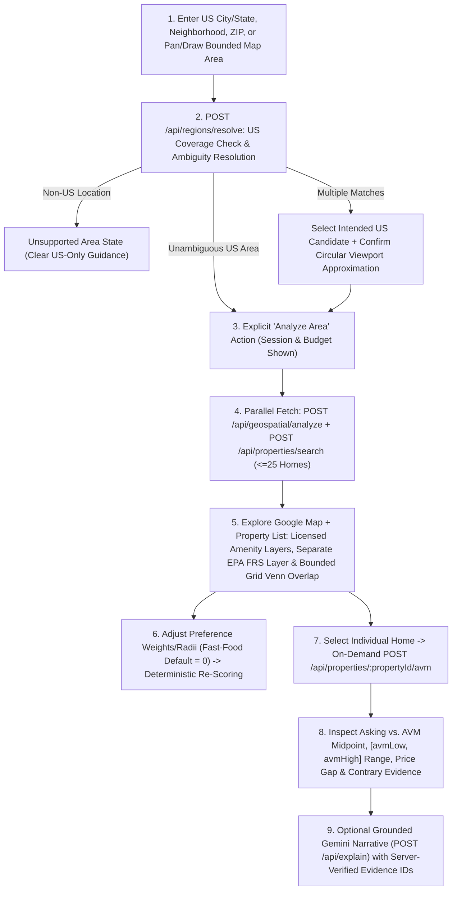

# Product Requirements Document (`PRD.md`)

**Product:** Foreal-Estate — Explainable US Real-Estate Location & Asking-vs-AVM Comparison Web Application  
**Owner:** `integrator`  
**Context:** Berkeley x DeepMind Hackathon MVP (Fresh-Code Prototype, November 13–14, 2026)

---

## 1. User Problem & Opportunity

Home shoppers evaluating residential listings in unfamiliar US cities or neighborhoods face three recurring pain points:

1. **Fragmented neighborhood convenience vs. environmental due diligence:** Consumer real-estate portals show single opaque "walkability" numbers or scattered map pins without letting shoppers express their own multi-category proximity priorities (grocery, parks, transit, healthcare, schools/libraries) or inspect documented federal environmental registry records separately from amenities.
2. **Headline asking prices without uncertainty context:** Automated Valuation Model (AVM) point estimates are frequently presented as ground-truth home worth, hiding wide confidence intervals (`[avmLow, avmHigh]`), comparable-listing circularity (when the active listing itself appears in the AVM's comparable set), stale listing dates, and structural mismatches.
3. **Unverifiable AI prose:** Generative AI summaries often invent distances, fabricate neighborhood claims, or conflate user lifestyle preferences with market-dollar appreciation.

**Foreal-Estate** solves this by pairing **deterministic, open-data geospatial scoring** and **bounded asking-vs-AVM uncertainty comparison** with **strictly grounded Gemini explanations** across **any user-selected US location**.

---

## 2. MVP Scope & Non-Goals

### In Scope (MVP)
- **Any US Location Selection:** Search by US city/state, neighborhood, 5-digit ZIP code, or bounded interactive map circle/viewport—never hardcoded to Berkeley, CA.
- **Ambiguity Confirmation & US Coverage Gate:** Explicit candidate disambiguation (e.g., `"Springfield"` -> Springfield, IL vs. Springfield, MO vs. Springfield, MA) and strict rejection of non-US coordinates/queries (`unsupported_area`).
- **Explicit Cost-Gated Area Analysis:** Upstream listing and geospatial fetches execute only when the user clicks **"Analyze area"** (zero RentCast calls on map pan/zoom or keystroke typing).
- **Interactive Google Map + Synchronized Property List:** Displays up to 25 active residential listings per search alongside toggleable licensed amenity markers (`osm_overpass` / `osm_extract`), a separate environmental due-diligence layer (`epa_frs`), and bounded regular-grid Venn-like multi-category overlap zones.
- **User-Editable Preference Profile:** Adjustable category weights ($w_c \ge 0$) and geodesic kernel radii ($\text{radius}_c$) for `grocery`, `parks`, `transit`, `healthcare`, `schools`, plus optional `fast_food` commercial context defaulting to **`0` weight**.
- **On-Demand Asking-vs-AVM Comparison & Contrary Evidence:** Clicking a specific home fetches (or serves from cache) its RentCast AVM midpoint (`avmPrice`), confidence bounds (`avmLow`, `avmHigh`), `gapPct`, `rangePosition`, comparable summary (including `subjectIncludedInComps` circularity check), `lastSalePrice`/`lastSaleDate`, and `assessedValue`.
- **Grounded Runtime Gemini Explanation (`POST /api/explain`):** Server-validated JSON narrative referencing only server-computed numbers and eligible `evidenceIds`, with graceful deterministic fallback if Gemini is unconfigured or times out.
- **Opt-In Badged Synthetic Demo Mode:** When `ENABLE_SYNTHETIC_DEMO_MODE=true`, users can explicitly activate badged synthetic fixtures (`SYNTHETIC DEMO DATA — NOT LIVE MARKET LISTINGS`) without consuming live quota or confusing synthetic data with real listings.

### Out of Scope (Non-Goals)
- Automated investment recommendations, financial/appraisal advice, or closed-sale MLS brokerage feeds.
- Walking/driving/transit network time-isochrone routing engines (MVP uses explicit WGS84 straight-line geodesic radii).
- Bulk property export, background scraping, or pre-fetching AVM estimates across unselected map markers.
- Demographic, resident, tenant, borrower, school test-score, crime-index, or protected-class scoring.

---

## 3. End-to-End User Flow

1. **Location Input:** The user enters any US city/state (e.g., `"Austin, TX"`, `"Seattle, WA"`, `"02139"`), neighborhood, or positions a bounded map circle (`radiusMeters` between `400 m` and `5,000 m`).
2. **Ambiguity Confirmation & Coverage Validation:** `POST /api/regions/resolve` checks US boundaries and returns either a single confirmed `AnalysisArea`, a disambiguation list (`status: "ambiguous"`), or `status: "unsupported_area"`. Every `AnalysisArea` explicitly flags `isViewportApproximation: true`.
3. **Explicit "Analyze Area" Trigger:** Before spending budget, the UI displays current session/global RentCast budget availability and triggers `POST /api/geospatial/analyze` and `POST /api/properties/search` only on explicit confirmation.
4. **Spatial Layer & Overlap Exploration:** Users inspect the Google Map basemap (or coordinate canvas fallback if `GOOGLE_MAPS_BROWSER_KEY` is absent), toggle licensed OSM amenity layers, toggle the separate US EPA FRS environmental due-diligence layer, and view the bounded grid/kernel Venn-like multi-category sweet-spot overlay.
5. **Home Selection & On-Demand Valuation Comparison:** Selecting a home triggers `POST /api/properties/:propertyId/avm` (up to 5 unique homes per default session; expandable to 10 via explicit user confirmation at `POST /api/sessions/:sessionId/expand`). The detail drawer presents `askingPrice`, `listingLastSeenAt`, `avmPrice`, `[avmLow, avmHigh]`, `avmFetchedAt`, `lastSalePrice`/`lastSaleDate`, `assessedValue`, `gapPct`, `rangePosition`, and structured **contrary evidence** (e.g., asking price inside AVM range despite positive `gapPct`, wide AVM range, or `subjectIncludedInComps: true`).
6. **Grounded Explanation:** Clicking **"Explain this comparison"** calls `POST /api/explain`. The backend validates that Gemini's structured response cites only eligible `evidenceIds` and matches deterministic server numbers; if unavailable, all deterministic tables and charts remain 100% functional.

---

## 4. Required UI States & Failure Resilience

Every panel and workflow explicitly handles and distinguishes all nine operational states without blank screens or silent data fabrication:

| UI State Code | Trigger Condition | User-Visible Behavior & Recovery Action |
|---|---|---|
| `setup_needed` | Missing `RENTCAST_API_KEY`, `GOOGLE_MAPS_BROWSER_KEY`, or `GEMINI_API_KEY` reported via `GET /api/config` | Names the missing capability (`Property API`, `Google Map Basemap`, or `AI Explanation`) using environment variable names only; offers deterministic fallback or opt-in badged `synthetic_demo` mode if enabled. |
| `loading` | Active in-flight region resolve, geospatial analysis, listing search, AVM lookup, or explanation | Accessible `aria-busy="true"` skeleton/spinner with cancel/stale-request protection so rapid clicks never overwrite newer selections with late responses. |
| `empty` | Healthy upstream response returned `0` active listings or `0` facilities in the selected radius | Clearly distinguishes *"0 active listings found in this radius"* (or $a_c = 0$ for 0 amenities) from upstream errors; suggests widening radius (up to `5,000 m`) or choosing a nearby area. |
| `partial` | One or more weighted geospatial categories or EPA FRS timed out while others succeeded (`completeness: "partial"`), or `/api/explain` failed while deterministic math succeeded | Displays exact `missingOrFailedCategories` badge, holds failed category weights in denominator (no silent renormalization), shows `knownWeightFraction`, and offers targeted retry. |
| `unsupported_area` | Non-US query/coordinates (e.g., `"Toronto, ON"`, `"London, UK"`, ocean coordinates) | Explains that RentCast residential listings and US EPA FRS cover the United States only; prompts user to select a US location. |
| `quota_exhausted` | Global monthly RentCast cap (`RENTCAST_GLOBAL_MONTHLY_LIMIT`, default `35`) or per-session cap (`6` default / `12` expanded) reached | Preserves all cached listings/AVMs and geospatial scores; offers explicit session expansion (`5 -> 10` AVMs) if only session cap was hit, or badged `synthetic_demo` if global cap was hit. |
| `timeout` | Upstream Overpass, EPA FRS, Geocoder, RentCast, or Gemini request exceeded strict server timeout | Reports which upstream service timed out without corrupting cached state; surfaces one-click **"Retry"** (`recovery`). |
| `recovery` | User retries after `timeout`/`partial`, switches region, or expands session allowance | Re-executes only the failed/requested step cleanly while preserving user preference sliders and selected property state. |
| `synthetic_demo` | User explicitly opts into synthetic demo mode when `ENABLE_SYNTHETIC_DEMO_MODE=true` | Renders persistent high-contrast **`SYNTHETIC DEMO DATA — NOT LIVE MARKET LISTINGS`** banner across map, list, detail drawer, and explanation panel. |

---

## 5. Mobile Responsiveness & Keyboard / Screen-Reader Accessibility

- **Responsive Layout (`360px` mobile to `1440px+` desktop):**
  - Desktop (`>= 1024px`): Split-pane workspace with search/controls header, interactive map + layer legend, scrollable property list, and property detail/AVM drawer.
  - Mobile/Tablet (`< 1024px`): Accessible tab/sheet switcher (`Map`, `Listings`, `Selected Home`, `Preferences`) with touch-friendly (`>= 44x44px`) targets and non-overlapping legends.
- **Full Keyboard Navigation & Focus Management:**
  - Every region candidate, layer toggle, preference slider (`<input type="range">` paired with numeric readout), property card, AVM trigger button, and detail drawer is reachable and operable via `Tab`, `Shift+Tab`, `Enter`, `Space`, and `Escape` without requiring map marker pointer precision.
- **Non-Color-Only Encoding & ARIA Semantics:**
  - Map markers, overlap cells, and `rangePosition` badges pair color with explicit text labels, shapes/icons, and numeric readouts (`+10.0% · Inside AVM Range`).
  - Live status announcements use `role="status"` / `aria-live="polite"` for loading, partial-data warnings, and budget updates.

---

## 6. Explicit Product Non-Claims & Ethical Guardrails

Foreal-Estate enforces seven non-negotiable guardrails across backend contracts, UI copy, and Gemini prompts:

1. **Never Hardcode Berkeley:** Berkeley, CA may appear only as one optional example placeholder among multiple US cities—never as a locked map center, hardcoded coordinate fallback, or restricted dataset.
2. **Viewport / Circle $\ne$ Official District Polygon:** Analysis regions use explicit circular geodesic radii (`centerLat`, `centerLng`, `radiusMeters`, `isViewportApproximation: true`) and never claim to represent official municipal, school-attendance, or neighborhood boundary polygons. Straight-line geodesic circles are not walking-time or transit isochrones.
3. **Commercial / Fast-Food Neutrality (Default Weight `0`, Zero Causal Claims):** Optional commercial/fast-food context (`fast_food`) defaults to weight **`0`**. Even if adjusted by a user for convenience exploration, the app **never** claims fast-food brands (e.g., McDonald's) or retail chains cause home price appreciation.
4. **Zero Demographic or Protected-Group Scoring:** No race, ethnicity, income, age, family status, religion, disability, resident/tenant/borrower profile, or crime-index features are ingested, inferred, or scored.
5. **Preference Score $\ne$ Market Dollars:** Accessibility scores ($0\text{–}100$) and optional externality preference composites represent uncalibrated user convenience preferences, never dollar valuation adjustments.
6. **Never Multiply AVM by Accessibility:** RentCast AVM values (`avmPrice`, `avmLow`, `avmHigh`) are never scaled, shifted, or multiplied by amenity or environmental scores.
7. **AVM $\ne$ Physical Appraisal or Proven Undervaluation:** RentCast AVM is a comparable-listing statistical estimate. A listing below the AVM midpoint (`gapPct > 0`) that remains inside `[avmLow, avmHigh]` is classified as `in_range` (normal statistical dispersion), and even `below_estimate_range_candidate` (`askingPrice < avmLow`) is presented strictly as a **candidate signal for human due diligence** alongside contrary evidence (condition, interior defects, lot/topography, stale listing, wide range, or subject-in-comps circularity).

---

## 7. MVP Acceptance Criteria

1. Resolving ambiguous US place names returns selectable US candidates; resolving non-US queries returns `unsupported_area` without calling RentCast.
2. Server source policy (`src/server/geospatial/sourcePolicy.ts`) unconditionally rejects `google_places_context` from scoring, grid heatmaps, feature storage, and `/api/explain` evidence even if tagged `analysisEligible: true`.
3. Permuting input facility arrays produces bit-identical accessibility scores; upstream Overpass timeout on a weighted category yields `status: "unknown"` and `completeness: "partial"` without silent denominator renormalization.
4. `AVM = 1,000,000`, `ask = 900,000`, `range = [850,000, 1,150,000]` computes `gapPct = +10.0%` AND `rangePosition = "in_range"`.
5. Server secrets (`RENTCAST_API_KEY`, `GEMINI_API_KEY`, `GOOGLE_PLACES_SERVER_KEY`) never appear in `GET /api/config`, client bundles, logs, or error payloads; durable budget store enforces `RENTCAST_GLOBAL_MONTHLY_LIMIT < 50` across server restarts.
